<picture>
  <source media="(prefers-color-scheme: dark)" srcset="docs/brand/my-agentic-fleet-mark-on-dark.svg">
  
</picture>

# My Agentic Fleet: Secure by Design

**Your own team of AI agents, on your own PC.** Open source. Free for everyone.

> **The code is not here yet.** We use My Agentic Fleet inside JQiT first. Then we publish it here.
> Press **Watch** at the top of this page. GitHub tells you when the first release lands.

[See how it works](https://jqit.com.au/products/agentic/) · [About JQiT](https://jqit.com.au/) · [Ask for a feature](../../issues/new/choose) · [Licence](LICENSE)

## 1 · Project overview

**The Architect is your personal agent.** It keeps its memory safe on your own PC, in files you own. It is also the lead of your whole fleet. It plans the work for every unit.

**Each unit has an Orchestrator and its workers.** The Orchestrator is always on. It hands each task to a worker.

```text
You
└── Architect: your personal agent, and the lead of the entire fleet
    ├── Unit 1: Coding Orchestrator ........... worker 1 · worker 2 · worker 3
    ├── Unit 2: Infrastructure Orchestrator ... worker 1 · worker 2 · worker 3
    └── Unit N: More Orchestrators ............ worker 1 · worker 2 · worker 3
```

**Vision.** Any time, anywhere, on any device. One person directs a whole fleet of AI agents.

**Strategy.**

- **It grows with you.** Start with one agent. Add a unit when you need one.
- **It works across AI vendors.** Use Claude or Codex today. Gemini is coming. An open AI model on your own PC is coming too.
- **It is hybrid.** Hybrid means your own PC and the cloud work together.
- **We use good products that exist.** We add only the practice. The practice is the set of rules your agents follow.
- **We use it ourselves first.** JQiT runs on it every day. We share a part only after we have used it.

<sub>source: the project's vision and strategy papers</sub>

## 2 · Information classification

🟢 **Public**

<sub>source: the Information Classification Standard</sub>

## 3 · Delivery state

**Build assurance** means the work is built right. The Orchestrator delivers it. Its dispatch system hands out each task by itself. The Architect audits the result.

Each part is in one of three states. **In daily use** means we use it every day at JQiT. **Piloting** means we are testing it now at JQiT. **Coming** means it is designed and not built yet.

| In daily use at JQiT | Piloting at JQiT | Coming |
|---|---|---|
| The Architect and the Orchestrator | The phone and browser screen (Happier) | One installer for your own PC |
| Workers that build, test and land changes | The AI gateway that counts each call and its cost | Agents sealed in a virtual machine |
| The morning brief | A team on a second AI vendor | The first release in this repository |
| Memory in plain files you own | | A fully local AI model |
| The design gate | | Several units and cloud hosts |
| Daily model tuning | | |
| The account pool | | |
| The delivery dashboard and status bar | | |

<sub>source: counted by hand on 22 November 2026</sub>

## 4 · Architecture View

### Current initiative: the foundation and one agent



Today VS Code reaches the PC by Microsoft's tunnel. The hands reach the brain by your own subscription or your API keys.

### Target state (roadmap)



In the target state you sign in at the front door first. The agents work in a sealed room. The hands can also reach an open model on your own PC.

**Legend:** 🟠 **New (amber)** = planned (target state) · ⬜ **Unchanged (grey)** = works today.

**Roadmap.**

1. **Start.** One agent on your own PC.
2. **One unit.** A full team for a one-person company.
3. **Several units.** One unit for each kind of work.
4. **Add the cloud.** Cloud hosts join when you need more power.
5. **Any time, any device.** Your fleet runs all day, across vendors and clouds.

<sub>source: the roadmap and the project's design papers</sub>

## 5 · Architecture alignment

**Design assurance** means the design is right before anything is built. Every architecture change and every design change passes one gate.

The gate is **AADG** (Agentic Architecture Design Governance). It reads the design against the **JQiT Reference Architecture**. That is our set of design rules.

An **architecture change** alters the big picture. A new vendor is one. Where your data sits is another.

A **design change** alters how one part is built. A **deviation** means the design leaves the target state.

```text
Architecture change
  Architect proposes ──> you approve ──> AADG reads it
                                           ├── no deviation ──> build
                                           └── a deviation ───> you approve again ──> build

Design change
  Architect designs ──> AADG reads it
                          ├── no deviation ──> build
                          └── a deviation ───> Architect fixes it ──> build
```

<details>
<summary>What the gate reads in every design</summary>

1. Where the design is heading.
2. The whole life of the thing: how it starts, runs, drifts and is put right.
3. Whether each part is needed.
4. That no security control is lowered.
5. That every open question is closed or booked.
6. That each part can be traced, is fast enough and still works at scale.
7. That you can see whether it is up, quick and right.
8. Whether a mature product already does the job.

</details>

**Deviations accepted for this repository:** none.

<sub>source: the Reference Architecture and <code>architecture-debt-register</code></sub>

## 6 · Risks

Repo risk, in plain words:

| Risk | What we do about it |
|---|---|
| An agent can make a mistake. | You set what an agent may do without asking. Tests and a second AI model check its work. |
| A private detail could reach this page by error. | Every change is scanned for known password patterns. A hit fails the check. |
| Your AI company can change its price or its terms. | You choose the AI. You can change to another one. An open model on your own PC is coming. |
| A date can move. | We do not promise a date. We publish a part only after we have used it. |

<sub>source: restated for public readers; the project's own risk register stays private</sub>

---

## Take part

We want to hear from you.

- **Have an idea?** [Ask for a feature](../../issues/new/choose).
- **Found a bug?** [Open an issue](../../issues/new/choose).
- **Have a question?** [Start a discussion](../../discussions).
- **Want to follow along?** Press **Watch**.

**Licence.** [Apache-2.0](LICENSE). You may use it, change it and share it.

**Names.** The names JQiT and My Agentic Fleet and the JQiT mark belong to JQIT Pty Ltd. The licence does not cover them.

Made in Melbourne by [JQiT](https://jqit.com.au/). Secure by Design. AI to Scale. Enterprise Ready.
